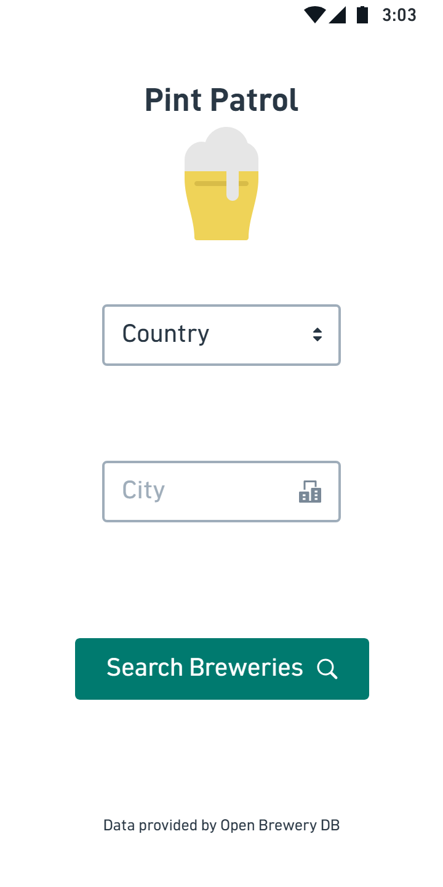
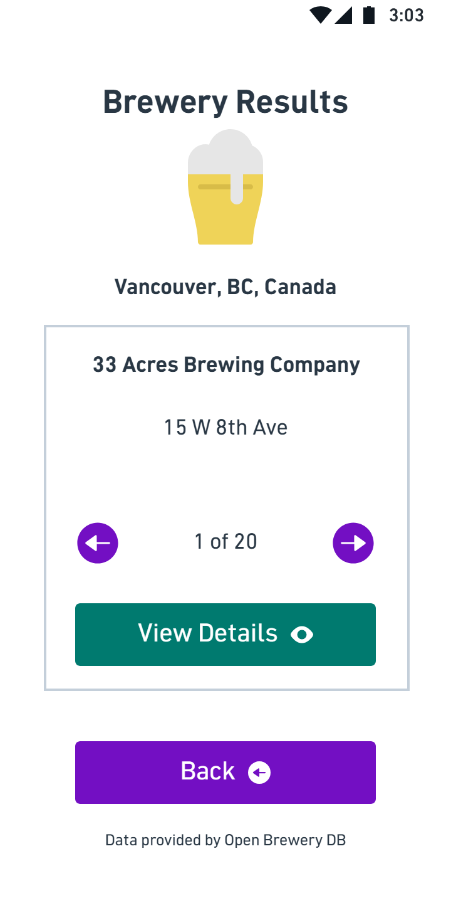
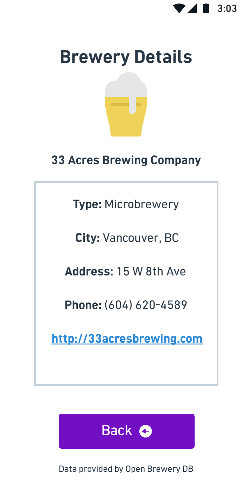
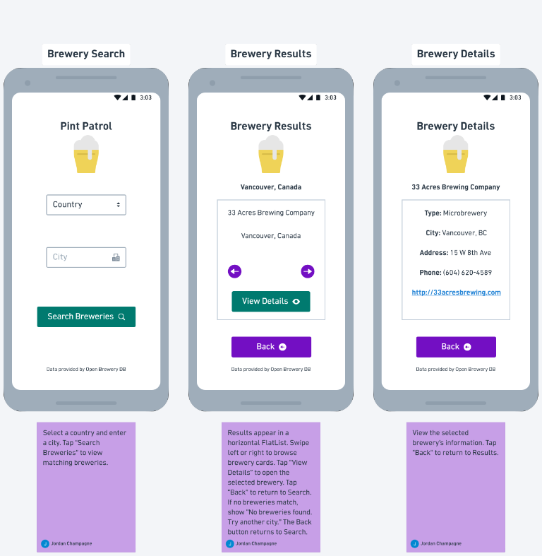

# Pint Patrol Project Proposal

## Team Information

**Team Name:** Pint Patrol Development

**Student:** Jordan Champagne

**Team Responsibilities:** Solo project — Jordan Champagne is responsible for 100% of the design, development, testing, and documentation.

**Course:** SODV2205-02 – Mobile Application Development with React Native I

---

## Project Overview

Pint Patrol is a React Native mobile application that helps users discover breweries using live data from Open Brewery DB. Users can search for breweries by Country, State/Province/Region, and City, browse results, and view detailed brewery information.

The application is intended for craft beer enthusiasts, brewery visitors, and travelers looking to explore breweries in different locations. Instead of searching multiple websites, users can access brewery information through a single mobile application.

---

## Project Objective

The objective of Pint Patrol is to provide a simple and user-friendly brewery discovery experience using a live third-party API.

Users will be able to:

- Search for breweries by location
- Browse brewery results
- View brewery details
- Open brewery websites directly in their device browser
- Discover random breweries using a "Random Brewery" feature

---

## Target Users

Pint Patrol is designed for:

- Craft beer enthusiasts discovering new breweries in their own city
- Travelers researching breweries for upcoming trips or exploring a city they are visiting
- Curious users who want a surprise suggestion through the "Random Brewery" feature

Each user group is served by a specific part of the application: local search through the linked dropdowns, location-based browsing of results, and one-tap random discovery.

---

## User Stories

- As a user, I want to search for breweries by selecting a Country, State/Province/Region, and City so that I can find breweries in a specific location.
- As a user, I want to browse the breweries in my selected city one at a time so that I can decide which one to view in detail.
- As a user, I want to tap a brewery to view detailed information, including its address, phone number, and website.
- As a user, I want to discover a random brewery so that I can find something new without searching.
- As a user, I want a layout that works on various screen sizes.

---

## Selected API

Pint Patrol will use Open Brewery DB, a free public API that provides brewery information without requiring an API key.

**API URL:**

https://api.openbrewerydb.org/v1/breweries

The API provides information such as:

- Brewery Name
- Brewery Type
- Address
- City, State/Province/Region, and Country
- Phone Number
- Website URL

Closed breweries will be filtered out before display. When a brewery does not provide a phone number, the application will display **"Unavailable"**.

---

## Planned Screens

### Screen 1 – Brewery Search

The Brewery Search screen allows users to search for breweries using linked dropdown selections for Country, State/Province/Region, and City.

**Features:**

- Country Dropdown
- State/Province/Region Dropdown
- City Dropdown
- "Search Breweries" Button
- "Random Brewery" Button

Users may either search for breweries in a specific location or view a randomly selected brewery. The Country, State/Province/Region, and City dropdowns are linked, and only locations containing breweries are listed. The "Random Brewery" button skips the search filters and navigates directly to the Brewery Details screen using the API's random brewery endpoint.

---

### Screen 2 – Brewery Results

The Brewery Results screen displays breweries returned from the API.

**Features:**

- Horizontal FlatList
- Brewery Cards
- Brewery Counter (example: "1 of 20")
- Navigation Arrows
- "View Details" Button
- "Back" Button

Users can browse brewery cards horizontally and select a brewery for additional information.

---

### Screen 3 – Brewery Details

The Brewery Details screen displays detailed information for the selected brewery.

**Features:**

- Brewery Name
- Brewery Type
- Address
- Phone Number
- "Website" Button
- "Back" Button

If a website URL exists, the "Website" button opens the page using React Native Linking. If no website is available, the button is disabled.

---

## Technical Implementation

Pint Patrol will be developed using the following technologies and services:

- React Native
- Expo
- Axios
- React Navigation
- Open Brewery DB
- Expo Vector Icons

The application will use:

- **useState** for user input and screen state management
- **useEffect** for API requests and lifecycle events
- **useReducer** where state becomes more complex, such as coordinating the linked search filters
- A custom **useApiData** hook to encapsulate API request logic, loading, and error states
- **FlatList** for efficient data presentation
- **Axios** with **async/await** for API communication
- **Flexbox** for responsive layout design
- **Reusable components** for maintainable code organization

Examples of reusable components include:

- Header
- BreweryCard
- NavigationControls
- SearchFilters

---

## Data Handling

The application will perform basic processing of returned API data to improve usability.

- Breweries marked as closed will be filtered out
- Missing phone numbers will display "Unavailable"
- Website URLs will open using React Native Linking
- Empty results will display a user-friendly message
- Connection errors will display retry options

---

## Error Handling and User Experience

The application will include:

- Loading indicators during API requests
- Connection error messages
- Retry functionality
- Empty-results messages when searches return no breweries
- Disabled "Website" button when no URL exists
- Responsive layouts using Flexbox
- Icons from Expo Vector Icons

---

## Wireframes

Three interface wireframes have been designed using Whimsical:

### 1. Brewery Search

### 2. Brewery Results

### 3. Brewery Details

The wireframes demonstrate the planned navigation flow and user interface structure for the application.

---

## Development Timeline

### Week 1

- Complete project proposal and wireframes
- Create GitHub repository
- Set up React Native Expo project
- Test Open Brewery DB API connectivity

### Week 2

- Configure React Navigation
- Build Brewery Search screen
- Implement Country, State/Province/Region, and City selection
- Begin Axios integration

### Week 3

- Develop Brewery Results screen
- Implement horizontal FlatList
- Add brewery filtering and data validation
- Implement Brewery Details screen

### Week 4

- Add website linking, loading indicators, and error handling
- Complete testing and bug fixes
- Refine UI and responsive layouts
- Prepare final presentation video and documentation

### Final Submission

- Complete final testing
- Update README and GitHub repository
- Submit project and presentation

---

## GitHub Repository

The project source code, wireframes, proposal documentation, and development progress will be maintained in the Pint Patrol GitHub repository throughout the project lifecycle.

Repository:

https://github.com/jordantchampagne-sudo/pint-patrol

The repository already contains:

- Phase 1 wireframes
- Project documentation
- README documentation
- Initial Expo project setup
- A working API connectivity test using Open Brewery DB
