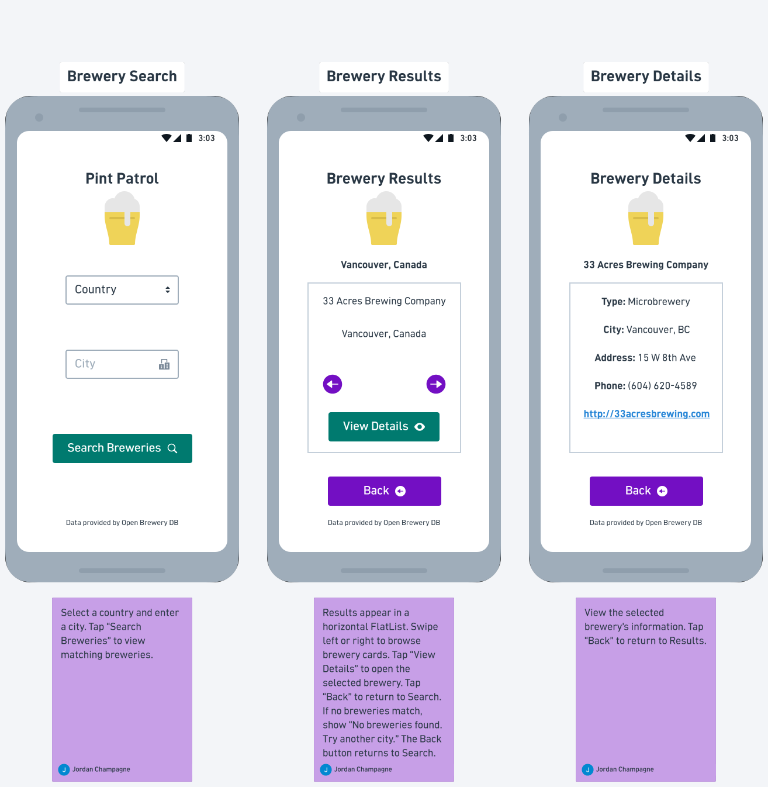

# Pint Patrol

Pint Patrol: a React Native brewery discovery app using Open Brewery DB.

## Project proposal

See [PintPatrolProposal.md](PintPatrolProposal.md) for the Phase 1 proposal, including objectives, target users, user stories, planned screens, technical plan, and development timeline.

## API

[Open Brewery DB](https://www.openbrewerydb.org/) provides the live brewery data. The planned app will let users search by country, state/province/region, and city, browse matching breweries, and view a brewery's details. A "Random Brewery" button will skip the search and open a surprise brewery's details directly.

- [API documentation](https://www.openbrewerydb.org/documentation)
- Base URL: `https://api.openbrewerydb.org/v1`
- Example search: [Breweries in Vancouver, Canada](https://api.openbrewerydb.org/v1/breweries?by_city=vancouver&by_country=canada)

The current app is a connection test that displays one random brewery using `fetch`. The planned search flow will use Axios with `async/await` to meet the course requirements. API coverage varies by location; some city searches may return no results.

## Contributions

This is a solo project, not a group project. The project author is responsible for the proposal, wireframes, app development, API integration, testing, documentation, and presentation.

## Screenshots and wireframes

These are Phase 1 design wireframes, not screenshots of implemented screens.

Wireframes created using [Whimsical](https://whimsical.com/).

Planned screen flow: **Brewery Search > Brewery Results > Brewery Details**.



- [Wireframe overview (PDF)](Wireframes/PintPatrolWireframes.pdf)
- [Brewery Search](Wireframes/PintPatrolBrewerySearch.png)
- [Brewery Results](Wireframes/PintPatrolBreweryResults.png)
- [Brewery Details](Wireframes/PintPatrolBreweryDetails.png)

## Run the app

Open a terminal (such as PowerShell). Navigate to the Pint Patrol project folder, then run these commands to start the app in Expo Go:

```
npm install
npx expo start
```

When the QR code appears, open the project in Expo Go. Keep your phone and computer on the same Wi-Fi network.

## Troubleshooting

If `npm` or `npx` is not recognized, install Node.js LTS, close and reopen the terminal, then try again.

If Expo Go cannot connect, confirm your phone and computer are on the same Wi-Fi network. Expo normally selects the local network automatically; if needed, stop the server with `Ctrl+C` and force LAN mode:

```
npx expo start --lan
```

For an Android phone, USB can be another option if Wi-Fi is unreliable. This requires USB debugging and Android Platform-Tools (`adb`). Connect the phone, approve the USB debugging prompt, stop the Expo server with `Ctrl+C`, then run:

```
adb devices
adb reverse tcp:8081 tcp:8081
npx expo start --localhost
```

On some Samsung Galaxy phones, Auto Blocker can block USB commands. If ADB cannot connect, open **Settings > Security and privacy > Auto Blocker** and long-press Auto Blocker to open its settings. Enable **Turn on automatically** if you want it to turn back on 30 minutes after you turn it off; otherwise, it stays off.

Press `a` in the Expo terminal to open the app on the connected phone. Optionally, run `scrcpy` in another terminal to mirror and control the phone while testing; it does not replace Expo or `adb`.

If Expo Go shows stale code or the bundle seems stuck, stop the server with `Ctrl+C`, then restart Expo and clear Metro's cache:

```
npx expo start --clear
```

This rebuilds the cache; it does not delete project files or phone data.

If Expo says the port is already in use, another development server may still be running. Stop it with `Ctrl+C` in its terminal if you no longer need it, or start Expo on a different port:

```
npx expo start --port 8082
```

Expo normally uses port `8081`. You can also choose another available port, such as `8002`. Scan the new QR code after restarting, since the connection address has changed.

For Android USB testing, the forwarded port must match Expo's port. For example, with port `8082`, run `adb reverse tcp:8082 tcp:8082` before starting `npx expo start --localhost --port 8082`.

## More help

If the steps above do not resolve the issue, see:

- [Expo Go setup](https://docs.expo.dev/get-started/start-developing/)
- [Expo troubleshooting](https://docs.expo.dev/troubleshooting/overview/)
- [Android Platform-Tools installation (`adb`)](https://developer.android.com/tools/releases/platform-tools)

## Optional: Record an Android demo

With scrcpy installed and your Android phone connected through USB debugging, run this in another terminal to mirror and record the phone:

```
scrcpy --record=pint-patrol-demo.mp4
```

Press `Ctrl+C` in that terminal to stop recording. The MP4 is saved in the terminal's current folder. This does not record your computer's microphone; record presentation narration separately.

- [Official scrcpy setup and usage](https://github.com/Genymobile/scrcpy)
- [scrcpy recording options](https://github.com/Genymobile/scrcpy/blob/master/doc/recording.md)

### Alternative: Record with Microsoft Teams

For a demo with microphone narration:

1. In Teams, open **Calendar**, select **Meet now**, and join the meeting by yourself. The button's location may vary by Teams version.
2. Open the app on your phone and mirror it with scrcpy.
3. Share the scrcpy window in the meeting and turn on your microphone.
4. Start the Teams recording, then demonstrate and explain the app.
5. Stop recording when finished. Once Teams finishes processing it, check playback and download the recording if your account permits it.

Recording availability and download permissions depend on your account and meeting policy. Make a short test recording first to confirm the app screen and narration are captured. Share only the app window and hide phone notifications to avoid recording unrelated information.
